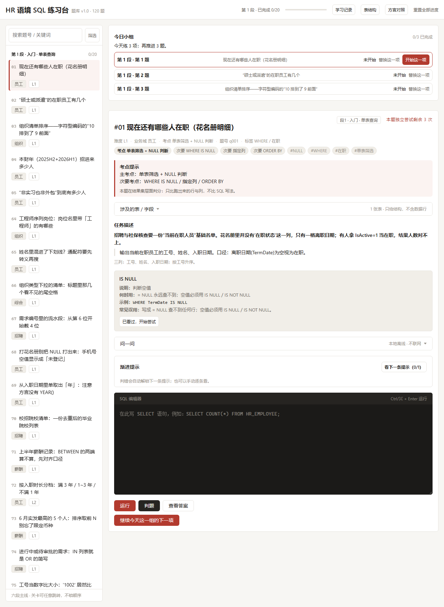
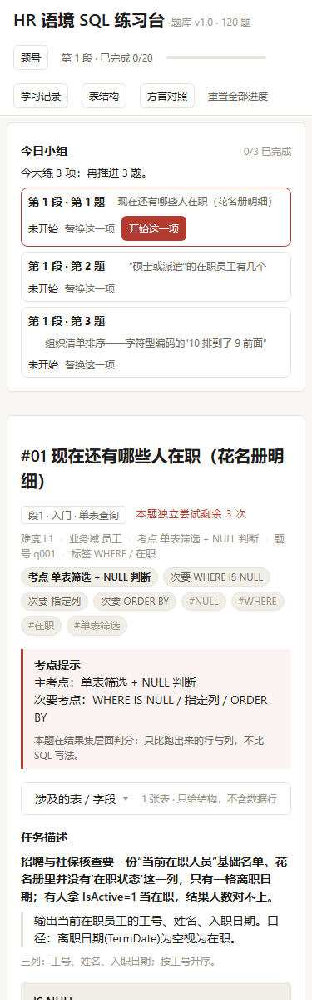
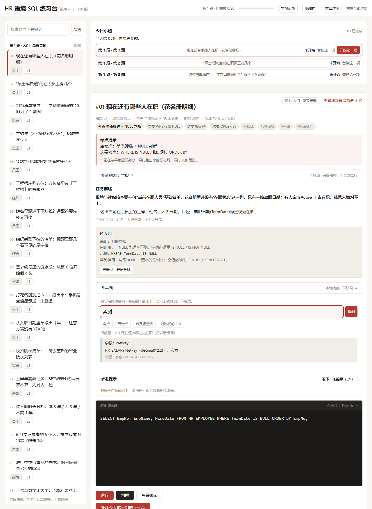

# DB Quest v2 · HR 语境 SQL 闯关（离线单文件）

> **一句话**：一个离线单文件的 HR 语境 SQL 闯关页 —— **120 题 · 6 段**，SQL Server（T-SQL）权威写法与 SQLite 网页实跑写法**双方言对照**。

**在线体验**：<https://hr-sql.page.coze.site> ｜ **源码**：<https://github.com/xiaoxiaozhaocai-pixel/hr-sql-practice>（MIT） ｜ **语言**：[English](README.en.md)



*图注 · 首页全景（桌面）：左栏六段主线，中栏题干、考点提示与语法卡，下方 SQL 编辑器与「问一问」入口；顶栏常驻「方言对照」。*

**关键事实**

| 事实 | 说明 |
| --- | --- |
| **120 题 · 6 段** | 按 `section` 自动分 6 段，段内按 `seq` 递进 |
| **T-SQL 与 SQLite 双方言对照** | SQL Server（T-SQL）权威写法 + SQLite 网页实跑写法，每题两种写法都给 |
| **单文件离线 · 零依赖零后端** | 约 1.9 MB 单个 HTML，双击即用、`file://` 可跑 |
| **MIT** | 开源许可；内联的 sql.js 1.14.2 同为 MIT |

全部数据为**虚构示例**，与任何真实单位、组织、系统、个人**零关联**。

## 快速上手

1. **在线玩**：打开 <https://hr-sql.page.coze.site>（无需注册、无需安装）。
2. **离线玩**：取单文件 [`dist/hr-sql-practice.html`](dist/hr-sql-practice.html)，双击打开即可（Chrome / Edge / Firefox 任一新版浏览器）。
3. **卡住了**：页面里随时打开「问一问」本地问答面板（零联网，数据不出本机）。

## 界面速览

| 手机竖屏 | 「问一问」面板 |
| --- | --- |
|  |  |
| *图注 · 手机竖屏（375px）：栏位与标签自动折行，无横向溢出。* | *图注 · 「问一问」面板：问「实发」直接给出字段与来源，本地问答、零联网。* |

---

## 工程细节（开发者）

一个**完全离线、零后端、零依赖**的多邻国式 SQL 闯关页：把权威数据库结构、种子数据、120 道 HR 业务题、
判题引擎与游戏化闯关壳全部打成一个 HTML 文件，双击即可闯关。产物 `dist/hr-sql-practice.html`
内联全部资源、不发起任何网络请求（构建自检会拦住任何外链）。

### 网络行为声明

1. **单文件包** `dist/hr-sql-practice.html`：WASM 执行引擎与题库数据均已内联，不请求任何外部资源，
   `file://` 双击打开即可用，无需服务端、无需 CDN。
2. **平台托管页（Coze 托管）**：在托管页面上，页面外会由**托管平台注入平台自己的统计脚本**。
   这些请求由托管平台在页面之外发起，**与题目数据、与本题库的判题逻辑无关，不是本应用发起的**。
3. 因此结论分两种形态：**「数据不出本机」两种形态都成立**（本应用不采集、不外发任何作答数据）；
   **「零网络请求」只有单文件包成立**，托管页不成立（原因见第 2 条，与平台行为有关，与本应用逻辑无关）。

- 关卡编排：题库按 `section` 字段自动分 **6 段**（段标题见 `src/levels.js` 的 `SECTION_TITLES`；当前 20 / 20 / 20 / 18 / 21 / 21，共 **120 题**），段内严格按 `seq` 递进
- 网页端执行引擎：**SQLite**（内联的 sql.js **1.14.2** / WebAssembly，WASM 以 base64 内联，**零 CDN**）
- 权威写法：**SQL Server（T-SQL）**，题库里以 `reference_sql` 字段保留，**只展示、不执行**
- 基准日：写死 `2026-06-30`，全库不使用任何动态时间函数
- 数据出处：**全部为虚构示例数据**，表名/机构/人名均为构造，与任何真实单位、组织、系统或个人**零关联**
- 进度只存本机浏览器 `localStorage`，**不采集、不外发、不做任何数据回传**（两种形态都不外发，详见上方「网络行为声明」）

---

## 1. 怎么用

### 直接闯关（使用者）

1. 双击打开 `dist/hr-sql-practice.html`（Chrome / Edge / Firefox 任一新版浏览器）。
2. 左栏是六段主线，点任意一关即可进入（**不锁顺序**；判错过的关会高亮，可点进去重刷）。
3. 在文本框写 SQL → 点「运行」看结果、点「判题」看结论。**Tab 键插入两个空格，不会跳走焦点。**
   - 超过 200 行的结果只渲染前 200 行并注明总行数。
   - 引擎报错**原样展示**，并附一句人话解释。
   - 命中本题 `forbidden_syntax` 时给**警告但不阻断**（提示该题在 SQL Server 里该用别的写法，仍允许跑）。
   - 想不出来点「再看一条」逐条解锁**渐进提示**（判错也会自动解锁下一条，不会一次甩完整答案）。
   - 「查看答案」**同时**给出 SQL Server 权威写法与 SQLite 网页可跑写法。
   - 过关后自动展开该题的易错点 `pitfalls` 与方言提示 `dialect_note`。
4. 首屏常驻「方言对照」条：SQL Server ↔ 本页 SQLite 的差异清单**不折叠、不隐藏**。
5. 顶栏只常驻 `第N段 x/y` 与题目 / 设置入口；XP、连续天数、今日目标进度、已完成 / 待复查题数收进可折叠的「学习记录」（键盘可达，展开态带 `aria-expanded`）。进度任何变化**立即写回** localStorage；刷新不丢。
6. 主列顶部是**今日小组**：优先到期复查题，再按 `section→seq` 补新题；每项标状态（未开始 / 进行中 / 已完成 / 待复查），进度用文字表达（如「今天练 3 项：复查 1 题，再推进 2 题」），**不挪回顶栏**。未完成项提供「替换这一项」（只走 `replacePlanItem`，换不了时给可读说明，不宣告达标）。
7. 一段全题通过后出现**独立段末总结**（完成 N/N、未看完整答案完成数、跟练完成数、待复查数、三个主要考点）；「下一步」按优先级**同时只突出一个主动作**，段末与今日目标同时达成时合并成一张结算、不连弹两次。
8. 顶部「重置全部进度」用页内确认卡二次确认（**不使用浏览器 `confirm` / `alert` 弹窗**）。

### 闯关规则

| 机制 | 规则 |
| --- | --- |
| 本题独立尝试 | 每题一轮 3 次，有效判错扣 1 次；扣光进入**跟练模式**（运行 / 改写 / 提示 / 看答案仍可用）。**不限制学习时长、不扣 XP、不回退课程**，不用全局红心制造资源焦虑 |
| XP | 首次完成 +10；**同一题重复通过不再加分**（全库封顶 1200） |
| 连续学习天数 | 每个本地自然日出现有效学习成果记 1 天；**断签不扣已有成果**，错过一天从上次位置继续、重新累计即可 |
| 每日目标 | 默认 3 项，新题与到期复查均可贡献；**当天计划建立后固定**，换题只走「替换这一项」；达成后「继续练」**不自动加码** |
| 待修正 / 待复查 | 判错记待修正；修正通过或跟练通过 → 预约次日复查；到期干净通过 → 移出待复查；再次出错重新打开 |
| 段末结算 | 该段最后一题首次通过（passed 从 N−1 到 N）出现独立总结；旧用户可回看，**不重发 XP**；末段给全库收束统计与待复查清单，不找不存在的题号 |
| 段位推荐 | 学习路径用**推荐式**解锁：段 1 默认推荐，前一段全题通过后下一段成为默认推荐；界面写「推荐下一段」，**不用灰锁阻止自由跳段** |
| 语法首现卡 | 新语法第一次出现时在题面上方出卡（是什么 / 何时用 / 最小示例 / 常见误用，内容见 `docs/syntax-cards-v1.md`）；点「已看过，开始尝试」收起为「语法回看」并可再展开，第二次判错的「回看入口：语法卡」也能展开已收起的卡。**已看过 / 回看只记阅读状态（`learning.syntaxSeen`），不加 XP、不计今日目标、不扣尝试次数** |

进度结构（键 **`dbquest.v2`**）：旧字段 `passed` / `xp` / `hearts` / `streak` / `todayCount` / `dailyGoal` /
`lastDay` / `wrong` / `current` / `sql` / `hintSeen` 保留兼容；状态机写入 `learning`
（`attempts` / `review` / `completions` / `syntaxSeen` / `sectionSummarySeen` / `daily` / `activity`）。
`hearts` 与 `streak` 只作历史值保留，**不再驱动新逻辑**。

> 首次打开需要初始化数据库（建表 + 灌 4842 行 + 11 表行数自检），通常 1~3 秒。
> **11 表自检不通过时页面顶部红条提示具体是哪张表差多少行，而不是白屏**；某题参考 SQL 跑不动或
> 行数与 `expected.row_count` 对不上时，该题打「⚠ 题库待复核」并**跳过判题、不消耗次数**（锅算题库，不算学员）。

### 构建与测试（开发者）

```bash
node build.mjs                                   # 零依赖打包，产出 dist/hr-sql-practice.html
npm test                                         # 判题引擎 / 关卡编排 / 段位轴 / 展示口径 / 建库 / 学习状态机（例数只增不减）
npm run verify                                   # 独立复核：真实 sql.js 重建库，120 题参考 SQL 与 expected 对账
```

不需要 `npm install`，`package.json` 的 `dependencies` 为空。也可以 `npm run build`。

> **重建数据库 / 改列类型 / 改题库后必跑 `npm run verify`**：它会用真实 sql.js 重建 `data/schema_sqlite.sql`
> + `data/seed_sqlite.sql`，逐题跑 `reference_sql_sqlite` 与 `expected` 对账（含 9 题「前 N 行样本」按序前缀比对、
> order_sensitive 题逐行比序）。失败时退出码 1 并打印题号与差异行。缘由见 `docs/known-limits-v1.md` 限制 3。

---

## 2. 目录结构

```
data/                      只读权威输入（不要改）
  schema_sqlite.sql        SQLite 建表 + 3 个视图
  seed_sqlite.sql          SQLite 插数（11 表 4842 行）
  rowcount_expected.json   11 表期望行数（启动自检用）
  questions.json           题库（唯一的题库来源；当前 120 题）
docs/                      文档（题目契约、口径裁定、转写说明）
vendor/sqljs/              只读的 sql.js 1.14.2 发行文件
src/
  levels.js                关卡编排 + 游戏化状态机 + localStorage 读写（纯逻辑，node 可直接 import）
  judge.js                 判题引擎（纯函数，node 可直接 import）
  db.js                    sql.js 加载 + 建库灌数 + 11 表自检
  app.js                   渲染层：把状态画成 DOM、把动作转成对上述模块的调用
  index.html               模板（含占位符）
  style.css                样式
test/
  judge.test.mjs           判题引擎 12 项口径单测
  quest.test.mjs           关卡编排 / 通关 / XP / 连胜 / 跨天 / 存储往返 10 项单测
build.mjs                  打包脚本（纯 fs，不 spawn 子进程、不引依赖）
dist/hr-sql-practice.html  构建产物（单文件，双击可跑）
```

分层原则（开源第 1 条）：**题库与逻辑分离**。题目全部在 `data/questions.json`；段/关的编排只在
`src/levels.js`；判题只在 `src/judge.js`；渲染只在 `src/app.js`。改任一层不需要动其它层。

---

## 3. 怎么加题 / 加关

题库与逻辑完全分离：**所有题目都在 `data/questions.json`**，加题不需要改任何 JS。

顶层结构：

```json
{
  "schema_version": "1.0",
  "db": { "dialect": "sqlite", "baseline_date": "2026-06-30",
          "source": ["schema_sqlite.sql", "seed_sqlite.sql"] },
  "questions": [ { "id": "q001", "...": "..." } ]
}
```

题目字段（消费端**必须忽略未知字段**，加字段不算破坏兼容）：

| 字段 | 类型 | 必填 | 说明 |
| --- | --- | --- | --- |
| `id` | string | ✔ | 唯一，形如 `q001`；发布后不复用、不改语义 |
| `seq` | int | ✔ | 展示序号（1 起），**段内按它升序排关**，可与 id 顺序不一致 |
| `title` | string | ✔ | 关卡标题，左栏与关卡页显示 |
| `subject` | string | ✔ | 业务域：`组织`/`员工`/`薪酬`/`考勤`/`招聘`/`绩效`/`综合` |
| `section` | int | ✔ | **段号 1–6，决定这题落进哪一段**（段标题见 `src/levels.js` 的 `SECTION_TITLES`） |
| `level` | int | ✔ | **1–4，决定难度标签与左栏筛选**（L1 单表 → L2 连接聚合 → L3 子查询/窗口 → L4 综合口径）；不再决定段号 |
| `knowledge_point` | string | ✔ | 主考点，关卡页「原理 / 考点提示」与左栏副标题显示 |
| `secondary_points` | string[] | — | 次要考点 |
| `stem` | string | ✔ | 业务背景 + 现象 |
| `requirement` | string | ✔ | 任务与口径（必须无歧义） |
| `output_hint` | string | ✔ | 要哪些列、是否排序、口径提示 |
| `hint` | string \| string[] | — | **渐进提示**，不得含答案写法。字符串按换行拆条；数组则一条一条解锁 |
| `approach` | string \| string[] | — | **可选：本题解题思路**——「先定产出 → 找表 → 连表 → 分层写 → 筛条件 → 自查」这类动作序列，**不含答案本身**。填了按它展示；不填由 `src/qa.js` 从 `output_hint` + `reference_sql` 结构派生 |
| `reference_sql` | string | ✔ | SQL Server 权威写法（可含 `dbo.`），**只展示不执行** |
| `reference_sql_sqlite` | string | — | SQLite 等价写法；与上文相同可省略 |
| `expected.columns` | string[] | ✔ | 预期列名（仅展示与对账，判题不依赖列序） |
| `expected.row_count` | int \| null | ✔ | 预期行数；`null` = 未固化 |
| `expected.rows` | array \| null | — | 展示用样本，最多前 50 行，**不参与判题** |
| `expected.order_sensitive` | bool | — | 默认 `false`（全库默认不要求行序） |
| `pitfalls` | string[] | ✔ | 坑位，写清「错在哪、为什么错」；通关后才展示 |
| `forbidden_syntax` | string[] | — | 本题禁用语法；命中时**只警告不阻断** |
| `dialect_note` | string | — | 本题的 SQL Server ↔ SQLite 差异提示；通关后才展示 |
| `tags` | string[] | — | 检索/筛选用 |
| `status` / `version` / `updated_at` | string | — | `draft`/`ready`/`retired`；修订号；`YYYY-MM-DD` |

**加题步骤**：

1. 在 `data/questions.json` 的 `questions` 数组里追加一条，`id`/`seq` 取未用过的值。
   `level` 决定它进哪一段 —— **编排层不写死关数，加题自动进段**。
2. `reference_sql` 写 SQL Server 版，`reference_sql_sqlite` 写能在本库直接跑的 SQLite 版（去掉 `dbo.`、
   `TOP n` → `LIMIT n`、`ISNULL` → `IFNULL`、`+` 拼串 → `||`）。
3. 把 `reference_sql_sqlite` 在库里实跑一次，把真实行数写进 `expected.row_count`，列名写进 `expected.columns`。
   **不要手算行数。**
4. 运行 `node build.mjs` 重新打包。

**加段**：`src/levels.js` 顶部的 `SECTION_TITLES` 登记 `level -> 段标题` 即可，其余不用动。

> 判题时预期结果是**现场**在同一个 SQLite 实例上跑 `reference_sql_sqlite` 得到的，不依赖写死的结果行。
> `expected.row_count` 只用于**对账**：跑出来对不上就打「⚠ 题库待复核」标记，并且**不判用户错、不扣心**。

---

## 4. 引擎依赖来自哪里

- 执行引擎 = **sql.js 1.14.2**（SQLite 编译到 WebAssembly），发行文件放在只读的 `vendor/sqljs/`
  （`sql-wasm.js` loader + `sql-wasm.wasm`）。
- `build.mjs` 把 `.wasm` 转成 base64 **内联**进 HTML；运行时用 `atob` 解成 `ArrayBuffer`，经
  `initSqlJs({ wasmBinary })` 传入，因此**绝不走 `locateFile` / `fetch`**，`file://` 双击可跑，**零 CDN、零外部请求**。
- 判题引擎、关卡编排、存储读写都是本项目自写的纯函数，无第三方依赖，`dependencies` 为空。

---

## 5. build.mjs 做了什么

1. 读 `vendor/sqljs/sql-wasm.js`（loader）与 `sql-wasm.wasm`（转 base64）。
2. 读 `data/schema_sqlite.sql`、`data/seed_sqlite.sql`、`data/questions.json`、`data/rowcount_expected.json`。
3. 读 `src/style.css`、`src/judge.js`、`src/levels.js`、`src/db.js`、`src/app.js`。
4. 全部按字面量塞进 `src/index.html` 的占位符，写出 `dist/hr-sql-practice.html`，并报出成品字节数。
5. **自检**：先把页面里的普通外链标签 `<a href="https://…">` 摘出并计数（只放行这一类，构建日志打印条数与目标地址），
   再把剩下的 HTML 交给 7 条外链检查：`http://`、`https://`、`<script src=`、`<link href=`、` verdict
```

返回 `{ pass, reason, columnIssue, diffRows, userRowCount, refRowCount, alignMode }`，差异行最多 10 条。

比对规则：

1. **只比结果集，绝不比对 SQL 文本**；同一条 SQL 的多种合法写法都能过。
2. **列数必须一致**，否则不通过（结论里列出两边列数）。
3. **列名默认不比**；列名与预期不同时只在 `columnIssue` 里提示「列名与预期不同」。
4. **列对齐**：优先按列名一一匹配（去首尾空格、大小写不敏感），匹配不上退回按列序；两种对齐**任一通过即通过**。
5. **行序不敏感**；行按**多重集**比较（重复行数量也必须一致）。`expected.order_sensitive` 为 `true` 时才按顺序比。
6. **数值四舍五入到小数点后 2 位**再比，`1` 与 `1.00` 相等；基于最短十进制表示逐位进位（`1.005 → 1.01`）。
7. `NULL = NULL` 视为相等；`NULL` ≠ `0` ≠ `''`（三种值各占独立 key）。
8. 字符串**大小写不敏感、忽略首尾空格**；无前导零的纯十进制字面量按数值处理（`'1.00'` 等于 `1`，`'007'` 仍是字符串）。
9. 日期按 ISO 文本 `YYYY-MM-DD` **直接比较**，绝不转时间戳。
10. SQLite 里布尔即 `1`/`0`，按数值处理。
11. 执行错误原样展示，不做任何包装。

---

## 7. 已知限制

- 判题只覆盖「结果集是否等价」，**不检查写法**：用不用窗口函数、是不是相关子查询、性能如何，一概不管。
- 只对**最后一条产生结果集的语句**判题；用户写多条语句时以最后一条的结果为准。
- 运行结果表最多渲染 200 行（超出只提示总行数），判题本身不受此限制。
- 参考 SQL 若在当前库上跑不动（方言没转干净），或行数与 `expected.row_count` 对不上，该题标「题库待复核」
  并跳过判题，**不判用户错、不扣心**。
- `expected.content_hash` 未启用；目前只做 `row_count` 对账。
- 进度存在 `localStorage`（键 `dbquest.v2`）；浏览器隐私模式或被策略禁用时，进度只在当前会话有效
  （代码已静默降级为内存存储，不报错）。
- 窄屏（< 1000px）左栏折叠为顶部抽屉，可用「收起 / 展开」按钮切换；桌面端的编辑器体验优先。
- 题库当前每题的 `hint` 是**单条字符串**（即每题 1 条提示）；渐进提示逻辑已按「多条」实现，
  加题时把 `hint` 写成数组即可一格一格解锁。
- 学习记录面板内的「学情诊断」只读汇总本机学习记录（完成 / 独立 / 待修正 / 到期复查 / 语法覆盖），
  不改变判题、题库与段进度口径；无学习记录时该块隐藏。

---

## 8. 口径裁定与待定点

1. **【已钉死 · 2026-10-09】列名默认不比。** 项目主人 2026-10-09 裁定：**列名默认不比**。
   此前有两处口径打架 —— 题目契约文档 `docs/questions-contract-v1.md` §5.2 写「列集合必须一致」（即要比），
   业务侧交付口径写「列名默认不比，只在差异区提示『列名与预期不同』」。
   现以主人裁定为准：**默认不比**，工程实现维持现状（`src/judge.js` 的 `namesSetEqual` / `columnIssue` 分支），
   列名与预期不同时只在结论里提示，不判错。
   契约文档 §5.2 原与该口径冲突（写「列集合必须一致」），**已由业务侧（HRIS）于 2026-10-10 书面裁定并同步修订**：
   正本《题目 JSON 契约 v1》§5.2 与《请读我_交付说明》§三-4 表述统一为「**列数必须一致；列名不比对**」，
   并补入《口径裁定 v1》新增裁定 6；另附《请读我_列名口径裁定_20261010》。
   裁定边界：别名、大小写、单复数、中英文列名差异**一律不判错**；`output_hint` 里的列要求属**教学提示、不进判题**；
   **列数不一致判不通过**。**工程侧实现无需改动**（与该裁定一致）。
   若日后改判「必须比」，改动点只有 `src/judge.js`，验证用例是 `test/judge.test.mjs` 的
   `different_column_names_same_position_passes_with_column_issue`。
2. `expected.row_count` 的固化范围：v1 记录（批1 录入前）为题 1..20 都有值；批1 追加的 13 题（seq 21..33）
   亦已按契约回填数值——「所有新题是否都必须回填」仍待业务侧确认。
3. `order_sensitive` 是否需要按题目可配（当前字段已支持，题库里都是默认 `false`）。
4. 数值口径的边界：`1.005` 这类恰好落在半分位上的值，是「十进制四舍五入到 1.01」（当前实现）
   还是「按 IEEE754 实际值截断到 1.00」？契约只写了「四舍五入」，未给边界例子。
5. `content_hash` 是否启用（当前不启用，只做行数对账）。
6. 每日目标是否要可配（当前固定默认 3 关，状态里已留 `dailyGoal` 字段）。

---

## 9. 许可

MIT，见 `LICENSE`。内联的 sql.js 1.14.2 发行文件同为 MIT。
